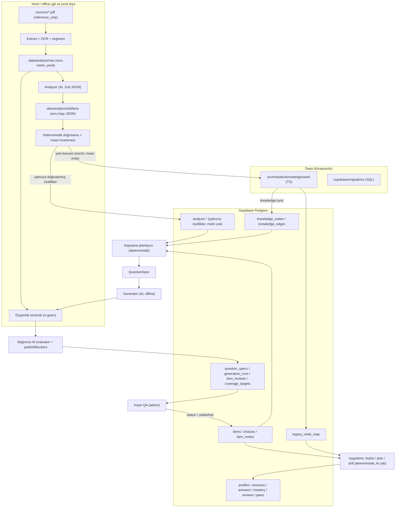

# Phase 0 — Depo Denetimi ve Geçiş Planı

Tarih: 7 Ekim 2026 · Kapsam: salt okuma denetimi. Bu belge dışında hiçbir dosya, şema, migration veya canlı veritabanı değiştirilmedi.

---

## 1. Özet

- **Elimizde ne var:** Çalışan, sade bir ürün. Next.js 15 + Drizzle + Supabase Postgres (yerelde PGlite). 102 özgün madde (80'lik deneme taslağı + 22'lik paket), 33 düğümlü iki seviyeli bir `skills` ağacı, deterministik puanlama / mastery / SRS / günlük plan, 40 soruluk seviye testi, rapor, kelime ve bağlaç drill'leri, Gelişim/Kamp paketleri. **Kodda hiç AI servisi yok.** Hiçbir tabloda foreign key yok. Şema, soğuk başlangıçta `init.sql` dosyasından uygulanıyor.
- **Canlı veritabanı neredeyse boş:** 0 kullanıcı, 0 profil, 0 mastery satırı. Sadece 3 misafir seviye testi (72 cevap) ve 74 event var. Taksonomi geçişinin bozabileceği gerçek öğrenci verisi bugün yok. Bu durum işimizi kolaylaştırıyor, yine de geçişi eklemeli (additive) tasarlıyoruz.
- **Spec ne istiyor:** Knowledge Graph → Question Graph → Learner Graph → Adaptive Engine. Spec iki ayrı belgeden oluşuyor (bkz. §2.1). Veritabanı tarafında B belgesi (Knowledge Graph & DB spec) daha somut ve daha yeni, bu yüzden onu esas alıyoruz.
- **Önerilen yol:** Dört küçük faz. **Faz 1** yalnızca taksonomi ve knowledge graph tablolarını kurar: `knowledge_versions`, `knowledge_nodes`, `knowledge_edges`, `legacy_node_map`. Eski `skills` ve çeldirici kodları yeni düğümlere eşlenir; mevcut tablolara dokunulmaz ve uygulamanın çalışma anı kodu değişmez. **Faz 2**, `sources/` içindeki geçmiş sınavları yerelde (offline) analiz edip **metin içermeyen** "YDS DNA" özelliklerine çevirir. **Faz 3** ise QuestionSpec → özgün üretim → AI QA → insan QA → bankaya kabul ve kapsama dengesi zincirini kurar. Learner graph ve adaptive engine, gerçek kullanıcı verisi oluşana kadar ertelenir.
- **Hemen bilinmesi gereken güvenlik bulguları:** `app_meta` tablosunda RLS kapalı (Supabase advisor: ERROR). Ayrıca `profiles_own` ve `subscriptions_own` politikaları `FOR ALL`. Data API açıksa giriş yapmış bir kullanıcı anon key ile kendi `role` alanını `admin` yapabilir veya kendine aktif Kamp aboneliği yazabilir. Uygulama Data API'yi hiç kullanmıyor; bu yüzden politikaları SELECT'e daraltmak ürünü etkilemez.
- **Senin vermen gereken kararlar (bkz. §8):** (1) ÖSYM ve yayınevi metinleriyle analiz politikası ve DNA'nın nerede tutulacağı, (2) migration aracı, (3) güvenlik düzeltmesinin zamanlaması, (4) AI sağlayıcısı ve anahtarlar, (5) pipeline'ın nerede çalışacağı, (6) OCR yöntemi, (7) `sources/` klasörünün git durumu.

---

## 2. Spec özeti

### 2.1 İki dosya arasındaki fark

İki dosya neredeyse aynı değil. Ortak satırların neredeyse tamamı boş satır ve ayraç; anlam olarak iki ayrı, birbirini tamamlayan belge bunlar:

| | A: `YDS-INTELLIGENCE-SPECIFICATION-v1.0.md` | B: `YDS Intelligence — Knowledge Graph, Taxonomy & Database Architecture Specification.md` |
|---|---|---|
| Değişiklik zamanı | 7 Ekim 11:44, 3369 satır | 7 Ekim 12:00, 3361 satır |
| Tür | Ürün vizyonu, intelligence mimarisi, UX, fiyat katmanları, kaynak/lisans stratejisi (115 bölüm) | Uygulama spec'i: tablolar, kolonlar, indeksler, RLS, Drizzle stili, seed sırası, analiz pipeline'ı, Cursor kuralları (98 bölüm) |
| Yalnızca A'da | Ürün akışı, ücretsiz döngü (10 kelime + 10 bağlaç), premium rapor, akademik kaynaklar (CORE, Semantic Scholar, DOAJ), edebi kaynaklar, özgün pasaj motoru, kalite skoru ağırlıkları, ÖSYM telif notu (FSEK), "wow anları", başarı metrikleri | — |
| Yalnızca B'de | — | Kolon kolon tablo tanımları, index stratejisi, JSONB/enum/UUID politikaları, `drizzle.config.ts`, migration politikası, seed sistemi, Zod analyzer sözleşmesi, `analysis/` artefakt klasörü, test listesi, 8 fazlı uygulama sırası |
| Çelişkiler | Düğüm türü başına ayrı tablo önerir (`concepts`, `grammar_concepts`, `discourse_relations`, `topics`…). Dosya tabanlı klasörler önerir (`questions/generated/`, `knowledge/…`). Uygulama sırası: domain → şema → taksonomi → kaynak → soru → QA → learner → … → üretim → UI | Tek `knowledge_nodes` tablosu ve tipli kenarlar. Kanonik kaynak PostgreSQL'dir. Uygulama sırası: denetim → DB temeli → question graph → kaynak → analyzer → üretim → learner → adaptive |

**Karar:** Veritabanı ve mimari için **B kanonik**, ürün yönü ve politika (telif, kaynak sınıfları, "AI üretir ama karar vermez") için A referans. Çelişen noktalarda B'yi uyguluyoruz: tek düğüm tablosu, dosya değil Postgres. A'nın klasör önerisini (`questions/approved/` vb.) reddediyoruz.

### 2.2 Spec'in çekirdek katmanları (sıkıştırılmış)

1. **Taksonomi:** Sınav (YDS, e-YDS, YDT, YÖKDİL…), 12 soru tipi, beceri listeleri (vocabulary 10, grammar 20, reading 11, discourse 12, cognitive 10).
2. **Knowledge Graph:** `knowledge_nodes` (tip + slug, `UNIQUE(node_type, slug)`) ve `knowledge_edges` (`UNIQUE(from, to, edge_type)`, 16 kenar türü). Gramer "yapısal" modellenir: *despite + noun/gerund*, *although + clause*. Misconception birinci sınıf nesnedir. Kelime ilişkileri kenarlarla tutulur.
3. **Question Graph:** `questions` (versiyonlu, durum makinesi `draft → generated → qa_failed/needs_review → approved → retired`, zorluk boyutları, provenance), `question_options` (çeldirici tipi ve gerekçesi), `question_concepts`, `question_skills`, `question_families`, `question_edges`.
4. **Kaynak ve analiz korpusu:** `sources`, `source_documents`, `source_licenses`. **Analiz korpusu** (`analysis_documents/questions/question_features`) üretim içeriğinden ayrıdır. Geçmiş sorular yalnızca referans ve kalibrasyon için kullanılır; üretim soruları özgün olmak zorundadır.
5. **YDS DNA:** Analiz korpusundan türetilen *kalibrasyon modeli*: soru tipi, konu, dağılım, çeldirici kalıpları, gramer/discourse kalıpları, zorluk dağılımı. Kopyalama modeli değildir.
6. **Üretim:** Önce `QuestionSpec` → Generator → deterministik doğrulama → bağımsız AI değerlendirme → özgünlük ve belirsizlik kontrolleri → insan onayı → banka. Kritik hata, ağırlıklı skordan bağımsız olarak reddedilir.
7. **Learner Graph:** `learners`, `learner_goals`, `learner_mastery` (7 durum), `learner_evidence`, `learner_errors`, `attempts` (değişmez), `learner_events`, `study_sessions`, `study_tasks`.
8. **Adaptive Engine:** `adaptive_decisions` kaydı, next-best-action (soru, tekrar, mini ders, …), açıklanabilir gerekçeler.
9. **AI rolleri:** Analyzer, Generator, Evaluator, Verifier, Explainer, Tutor. Her AI çıktısı Zod ile doğrulanır. AI önerir, domain doğrular, DB saklar.

### 2.3 Erken veya fazla mühendislik olan kısımlar (açıkça)

Aşağıdakiler bu ürünün bugünkü ölçeğinde (0 kayıtlı kullanıcı, 102 madde, AI yok) ya erken ya da mevcut yapının kopyası:

- **Learner graph tablolarının tamamı** (`learners`, `learner_goals`, `learner_evidence`, `learner_errors`, `attempts`, `learner_events`, `study_sessions`, `study_tasks`, `adaptive_decisions`). Bunlar `profiles`, `answers`, `events`, `sessions`, `plans` ile büyük ölçüde örtüşüyor. Kullanıcı verisi yokken ikinci bir öğrenci modeli kurmak, iki mastery hesaplayıcı (spec'in kendi yasağı) demek. **Ertele.**
- **7 mastery durumu, forgetting_risk, Bayesian güncelleme, IRT.** Veri yok. Mevcut deterministik mastery + SRS yeterli. **Ertele.**
- **Akademik ve edebi kaynak hattı** (CORE, Semantic Scholar, DOAJ, Gutenberg), kaynak kalite skoru, özgün pasaj motoru. Değerli olabilir ama YDS DNA'dan sonra gelir. **Ertele.**
- **pgvector ve embedding'ler.** Canlıda yüklü değil. Özgünlük kontrolü ilk aşamada n-gram örtüşmesiyle yapılabilir. **Faz 3 sonuna ertele.**
- **`question_edges` (harder_than, reinforces…)**, Tutor/Explainer AI rolleri, "Why this question?" UI. **Ertele.**
- **Ayrı `misconceptions` tablosu** (B) ve düğüm türü başına ayrı tablolar (A). Tek `knowledge_nodes` tablosu varken bunlar tekrar. Misconception'ı `node_type = 'misconception'` olarak tutuyoruz.
- **Fazla kenar türleri:** `child_of` (`parent_of`'un tersi), `depends_on`/`requires`/`prerequisite` (aynı anlam), `supports`. Tek yönlü ve az sayıda kenar türü yeterli.
- **Her şeyi UUID yapmak ve `questions` diye yeni bir tablo açmak.** Mevcut `items` (text id) çalışıyor ve cevaplar ona bağlı. Yeni bir soru tablosu açmak "duplicate question model" olur. `items` genişletilmeli.
- **`exams` tablosu.** İki sınav (YDS, YDT) ve resmi kitapçık düzeni zaten `blueprint.ts` içinde, test edilmiş halde duruyor. Tabloya taşımak bugün kazanç sağlamıyor. **Ertele.** Kavram dağılımlarının ise DNA'dan *empirik* türetilmesi gerektiği konusunda spec'e katılıyoruz.
- **Repository / Domain Service katmanlarını spec'teki adlarla baştan kurmak.** Mevcut `modules/*` (saf, deterministik) + `server/*` (IO) ayrımı zaten bu katmanlamayı karşılıyor. Yeniden adlandırmak değer üretmez.

---

## 3. Mevcut durum envanteri

### 3.1 Teknoloji

- Next.js 15.5 App Router, React 19.1, TypeScript 5.9 (strict), Tailwind v4, Zod 4, Vitest 3.
- `drizzle-orm` 0.44.6. Üretimde `postgres` (postgres-js), yerelde `@electric-sql/pglite`. **`drizzle-kit` ve `drizzle.config.ts` yok.**
- `@supabase/ssr` ve `@supabase/supabase-js` **yalnızca Auth için** kullanılıyor; kodda hiçbir yerde Data API (`supabase.from(...)`) çağrısı yok.
- Vercel `fra1`. Supabase projesi `mptxspvqkiqkkwbhbbqc`: PostgreSQL 17.11, DB boyutu 11 MB.
- Yüklü eklentiler: `plpgsql`, `pg_stat_statements`, `uuid-ossp`, `pgcrypto`, `supabase_vault`. **`vector` yok.**
- Depoda `.cursor/rules`, `AGENTS.md` ve `supabase/` klasörü yok. Ürün fikir belgeleri: `IDEA.md`, `COPY_IDEA.md`, `TUYO.md`.

### 3.2 Şema uygulama mekanizması

- `src/db/init.sql` (198 satır) ↔ `src/db/init-sql.ts` (tek satır JSON string). **İkisi birebir aynı** (doğrulandı). Yeniden üretme script'i `package.json` içinde yok; dosya elle üretiliyor.
- `client.ts → prepare()`: `app_meta.schema` içindeki hash (`init.sql` + taslak sayıları) farklıysa `migrate()` çalışır. `migrate()` SQL'i **`;` karakterinden bölerek** çalıştırır; bu yüzden `DO $$ … $$` blokları veya fonksiyonlar bu yolla uygulanamaz. Ardından `seed()` (items boşsa) ve `syncPack()` çalışır. Canlı hash: `45a69f2e3aa606a5`.
- Bu mekanizma üretimde **uygulama kullanıcısının yetkisiyle DDL çalıştırır**. Eşzamanlı soğuk başlangıçlarda aynı DDL'i yarıştırabilir; `IF NOT EXISTS` sayesinde bugün zararsız.
- `rls.sql` soğuk başlangıçta **uygulanmıyor** (`auth.uid()` PGlite'ta yok). Canlıya Supabase migration olarak elle uygulanmış: `20261003203704_enable_row_level_security`, `20261007081346_drill_answers_own_policy`. Bu iki migration'ın dosyası depoda yok.

### 3.3 Tablolar (canlı satır sayıları, 7 Ekim 2026)

Hiçbir tabloda foreign key yok (`information_schema` sayımı: 0). Tüm id'ler uygulama tarafında üretiliyor.

| Tablo | Kolonlar (özet) | Satır | Kullanım |
|---|---|---|---|
| `profiles` | id uuid PK (= auth user id), email unique, password_hash, role, target_score, exam_date (text), daily_minutes, prior_score, estimated_low/high, exam, streak, last_mission_date, onboarding_completed, created_at | 0 | Profil, onboarding, rol (admin). `password_hash` yalnızca yerel/PGlite girişi için. |
| `stimuli` | id text PK, kind (passage/cloze/dialogue/numbered), body | 26 | Cloze, okuma, diyalog ve numaralı metinler |
| `items` | id text PK (`item-N`, `pack-N`), slot, section, layout, direction, stem, explanation, difficulty 1–5, status (draft/published/booklet), stimulus_id | 102 | Soru bankası. 72 `published` + 30 `booklet` (yalnızca deneme sınavında kullanılır). |
| `choices` | id text PK, item_id, position, body, correct, distractor_type | 510 | 5 şık; yanlış şıkta çeldirici kodu zorunlu |
| `skills` | id text PK, parent_id, name | 33 | 11 kök (= bölüm id'leri) + 22 yaprak. **Kök id'ler `blueprint.ts` bölüm id'leriyle aynı ve kod buna dayanıyor.** |
| `item_skills` | (item_id, skill_id) PK | 106 | Madde ↔ beceri. Yetim kayıt yok, becerisiz madde yok. |
| `vocabulary` | id, word, meaning_tr, part_of_speech, example | 12 | **Yalnızca seed yazıyor, hiçbir yer okumuyor (ölü).** |
| `vocab_links` | id, from_id, to_id, kind | 4 | **Ölü** |
| `item_vocabulary` | (item_id, vocabulary_id) PK | 6 | **Ölü** |
| `sessions` | id uuid, profile_id, guest_id, mode (diagnostic/practice/simulator), exam, status, score, correct/wrong/blank_count, started/submitted/ends_at | 3 | 3 misafir seviye testi, hepsi gönderilmiş |
| `session_items` | (session_id, item_id) PK, position, flagged | 72 | Oturumdaki maddeler |
| `answers` | id uuid, session_id, profile_id, item_id, choice_id, correct, response_time_ms, confidence, created_at; unique(session_id, item_id) | 72 | 41 doğru, 10 yanlış, 21 boş; hepsi misafir. Seviye testi ve denemede cevap değiştirilince satır **güncelleniyor** (değişmez attempt kaydı değil). |
| `mastery` | (profile_id, skill_id) PK, mastery 0–100, confidence, attempts, correct_attempts, updated_at | 0 | `applyMastery` beceri başına günceller. `confidence` alanına mastery değerinin aynısı yazılıyor (yer tutucu). |
| `reviews` | id text (`profile:type:target`), target_type (item/word/connector), target_id, due_at, step, lapses, stability_days | 0 | SRS. `target_type='vocab'` **hiç yazılmıyor**; bu yüzden plandaki kelime blokları hep boş geliyor. |
| `plans` | id, profile_id, plan_date, payload jsonb; unique(profile, date) | 0 | Günlük plan önbelleği |
| `subscriptions` | profile_id PK, plan, status, provider, period_end | 0 | Gelişim/Kamp yetkisi |
| `events` | id, profile_id, name, payload jsonb | 74 | Analitik log. Yalnızca yazılıyor, okunmuyor. |
| `drill_answers` | id, profile_id, kind (word/connector), target_id, question_id, correct, day; unique(profile, day, question) | 0 | Günlük drill sonuçları |
| `app_meta` | key PK, value | 1 | Şema hash'i. **RLS KAPALI.** |

`auth.users`: 0 satır.

### 3.4 RLS ve güvenlik (canlı)

- `app_meta` dışındaki 18 tabloda RLS açık. `app_meta` için advisor `rls_disabled_in_public` (ERROR) veriyor. Data API açıksa anon key ile okunup yazılabilir. Sebep: `init.sql` bu tabloyu RLS açmadan oluşturuyor.
- `items`, `choices`, `stimuli`, `skills`, `item_skills`, `vocabulary`, `vocab_links`, `item_vocabulary`: RLS açık, politika yok, yani istemciye tamamen kapalı. Doğru tercih; advisor bunu yalnızca INFO olarak bildiriyor.
- Kullanıcıya ait 10 tablodaki `*_own` politikalarının hepsi `FOR ALL TO authenticated`. **Risk:** giriş yapmış bir kullanıcı anon key ile
  - `profiles.role = 'admin'` yazabilir. Admin sayfaları rolü DB'den okuduğu için bu bir yetki yükseltmesidir.
  - `subscriptions` tablosuna kendi `kamp/active` satırını ekleyebilir. Bu da ücretli paketi bedavaya açar.

  Uygulama Data API kullanmadığı ve sunucu RLS'i bypass eden sahip rolüyle bağlandığı için bu politikaları SELECT'e daraltmak (veya kaldırmak) ürünü bozmaz. **Bu fazda değiştirilmedi** (bkz. Karar 3).
- Performans advisor'ı: 5 kullanılmamış index (`events_name`, `sessions_profile_mode`, `sessions_guest_mode`, `answers_profile_created`, `drill_answers_profile_kind`). Trafik yok; şimdilik dokunma.

### 3.5 Taksonomi ve beceriler

- **`skills` (33):** Kökler `vocabulary, grammar, cloze, sentence, translation, reading, dialogue, situation, restatement, paragraph, irrelevant`. Yapraklar `academic-vocabulary, collocation, tenses, connectors, conditionals, relative, passive, prepositions, cloze-context, sentence-link, translation-en-tr, translation-tr-en, detail, inference, reference, main-idea, purpose, dialogue-intent, situation-line, restatement-shift, paragraph-flow, irrelevant-break`.
- **Bağımlılıklar (yeniden adlandırma ve yeniden seed yasağının sebebi):**
  - `ensureDailyPlan` beceriyi `parent_id` zincirinde yürüterek bölüm id'sine çevirir.
  - `/ilerleme` sayfası `parent ?? skillId` ile **iki seviyeli** ağaç varsayar.
  - `report.ts` `connectors`, `sentence-link`, `collocation`, `inference`, `main-idea` id'lerine isimle bakar.
  - `labels.ts → skillName()` Türkçe adları id ile eşler.
  - Admin editörü `skills` tablosunun tamamını checkbox olarak listeler.

  Sonuç: yeni taksonomi `skills` tablosunun **içine değil, yanına** kurulmalı.
- **Çeldirici kodları (canlı `choices` sayıları):** `LOGICAL_ERROR` 162, `CONTEXT_MISMATCH` 133, `CONNECTOR_ERROR` 35, `GRAMMAR_TRAP` 24, `COLLOCATION_ERROR` 13, `TRANSLATION_SHIFT` 12, `TENSE_ERROR` 11, `VOCAB_SIMILAR_MEANING` 9, `REFERENCE_ERROR` 9. `report.ts` (trapTips) ve `labels.ts` bu kodlara dayanıyor; spec'in snake_case ontolojisiyle farklı adlandırılmış ama eşlenebilir durumda.
- **Kodda duran taksonomi varlıkları:**
  - `content/drill-connectors.ts`: 45 bağlaç. Her biri bir discourse ilişkisine (contrast, concession, cause, result, addition, similarity, condition, purpose, example, time) ve bir sözdizimsel türe (`conj` + cümle, `prep` + isim/-ing, `adv` + cümle başı virgül, `inf` + yalın fiil) bağlı. Dosyada 60 bağlaç cümlesi de var. **Bu, spec'in "grammar must be structural" fikrinin çalışan bir örneği** ve Faz 1 seed'inin ana kaynağı.
  - `content/drill-words.ts`: 80 kelime (pos, anlam, örnek, `sense` grubu).
- `blueprint.ts`: YDS ve YDT kitapçık düzenleri, 11 bölüm, 5 layout, teşhis kotası (40). Spec'in "exam model"inin karşılığı.

### 3.6 Soru modeli ve içerik hattı

- Maddeler TS taslaklarından (`exam-draft.ts`: 80, `pack-draft.ts`: 22) seed ediliyor. Tüm metinler ekip tarafından yazılmış özgün içerik; ÖSYM metni yok.
- **Yayın kapısı** `modules/content/publish.ts → publishBlockers()`: kök uzunluğu, açıklama, zorluk 1–5, en az bir beceri, tam bir doğru şık, 5 şık, boş şık yok, yanlış şıkta çeldirici tipi zorunlu, layout kuralları. Spec'in "deterministic rule engine"inin çekirdeği zaten burada.
- **Eksikler:**
  - Versiyonlama yok. Admin editörü (`saveItemAction`) yayınlanmış maddeyi yerinde değiştiriyor; eski cevaplar değişmiş içeriğe işaret ediyor.
  - Provenance, soru tipi düğümü, zorluk boyutları ve çeldirici gerekçesi yok.
  - Madde ↔ kavram bağı yalnızca `item_skills` üzerinden kuruluyor.

### 3.7 AI servisleri

**Yok.** Bağımlılıklarda AI SDK yok, kodda LLM çağrısı yok, `.env.example` içinde AI anahtarı yok. Ürün kuralı ("AI soru seçmez; puanlama, SRS ve plan deterministik") kodda fiilen sağlanıyor.

### 3.8 Sunucu katmanı ve API

- `server/auth.ts`:
  - Supabase Auth etkinse (`NEXT_PUBLIC_SUPABASE_URL` + anahtar varsa) `sb-*` çerezinden kullanıcıyı alır (60 sn bellek önbelleği). İlk girişte `profiles` satırını oluşturur; `ADMIN_EMAILS` listesindekilere admin rolü verir.
  - Supabase kapalıysa yerel HMAC imzalı `tomo_session` çerezi ve `password_hash` kullanılır.
  - Misafirler `tomo_guest` çerezi taşır. `claimGuest` girişte misafir oturumlarını ve cevaplarını profile bağlar.
- `server/sessions.ts` (582 satır): oturum oluşturma (teşhis, pratik, simülatör), cevap kaydı, `applyMastery`, `touchReview`, gönderim ve puanlama, streak, `ensureDailyPlan`, abonelik aktivasyonu, misafir sahiplenme.
- `server/drills.ts`: günlük kelime ve bağlaç drill'leri, haftalık oranlar, zayıf ilişkiler. `server/report.ts`: rapor girdisi. `server/actions.ts`: tüm server action'lar (giriş, onboarding, oturum, cevap, drill, ödeme, admin madde kaydı).
- API: `/api/health` (DB ping), `/api/billing/webhook` (iyzico, Zod doğrulamalı).

### 3.9 UI rotaları

- **Public:** `/`, `/[slug]` (SEO rehberleri), `/deneme`, `/fiyat`, `/giris`, `/rehber`, `/rehber/[section]`, `/teshis`, `/yds-puan-hesaplama`.
- **Çalışma alanı:** `/bugun`, `/hatalar`, `/ilerleme`, `/kelime`, `/baglac`, `/odeme`, `/profil`, `/rapor`, `/setler`, `/setler/[id]`, `/admin`, `/admin/maddeler/[id]`.
- **Oturum:** `/oturum/[id]`, `/oturum/[id]/sonuc`.
- **Canlı huni:** 40 soruluk teşhis → rapor (3 bulgu ücretsiz) → drill'ler (günde 10 + 10) → Gelişim (499 TL / 90 gün) ve Kamp (2490 TL / 180 gün).

### 3.10 Testler

8 dosya, 31 test, hepsi geçiyor (`npx vitest run`, 2,5 sn). Testler saf fonksiyonları ve taslak bütünlüğünü kapsıyor. **Veritabanı, RLS, migration veya server action testi yok.**

### 3.11 `sources/` klasörü

- Toplam 28 MB, 10 dosya: 8 PDF + 2 Markdown (spec'ler).
- `.gitignore` içinde `*.pdf` var, bu yüzden PDF'ler hiç takip edilmemiş (git geçmişinde yok). İki `.md` dosyası **takip edilmiyor ama ignore da edilmiyor**; dikkatsiz bir `git add .` ile commit'e girer. `.data/` ignore ediliyor.

| Dosya | Boyut | ~Sayfa | Tahmini tür | Metin katmanı |
|---|---|---|---|---|
| `2013-2021-YDS-CIKMIŞ-SORULAR.pdf` | 8,1 MB | ~455 | ÖSYM geçmiş sınav derlemesi | Var (font ağırlıklı) |
| `2024 Kasım YDS_….pdf` | 4,5 MB | ~18 | ÖSYM sınavı | **Taranmış görünüyor** (452 görüntü, 4 font) → OCR gerekir |
| `EYDS-Gecmiş-Yıl-Butun-Sorular.pdf` | 2,4 MB | ~206+ | e-YDS derlemesi (Word çıktısı) | Var |
| `YDS-4000-kelime.pdf` | 0,8 MB | ~90 | Yayınevi kelime listesi | Var |
| `YDS-COZUMLU-MODULER-SORU-BANKASI.pdf` | 3,9 MB | ~409 | **Ticari yayınevi soru bankası** (çözümlü) | Karışık |
| `ing_yd1d09032025_….pdf` | 0,8 MB | ~30 | ÖSYM kitapçığı (2025, adlandırmaya göre) | Var |
| `pdfcoffeecom_2024-mart-yds-….pdf` | 7,2 MB | ~46 | Üçüncü taraf yüklemesi (ÖSYM 2024 Mart) | **Taranmış görünüyor** → OCR |
| `pdfcoffeecom_22-ekim-2023-yds-….pdf` | 0,6 MB | ~22 | Üçüncü taraf yüklemesi (ÖSYM 2023 Ekim) | Var |

Sayfa sayıları PDF nesne sayımından çıkarılmış kaba tahminlerdir; `pdfinfo` kurulu değil. Telif durumu: ÖSYM soruları FSEK kapsamında (spec A §20 de bunu not ediyor). Soru bankası ve kelime listesi yayınevlerinin eseri. `pdfcoffee` dosyalarının yükleme kaynağı belirsiz. Hepsi **"reference_only"** sınıfında ele alınmalı.

---

## 4. Karşılaştırma tablosu

Aksiyon değerleri: **koru** / **genişlet** / **ekle** / **çıkar** / **ertele**.

| Spec kavramı | Mevcut karşılık | Boşluk | Aksiyon (faz) |
|---|---|---|---|
| Exam (çoklu sınav) | `blueprint.ts` (YDS, YDT), `profiles.exam`, `sessions.exam` | Tablo yok, ama gerek de yok | **Koru**. `exams` tablosunu ertele. |
| Question types | `sections` + `layouts` (blueprint) | Düğüm olarak yok | **Ekle**: `node_type='question_type'` düğümleri, eski bölüm id'leri eşlenir (F1) |
| Skill taxonomy | `skills` (33, 2 seviye) | Gramer/okuma/cognitive listeleri eksik | **Koru** + **ekle**: yeni düğümler, `legacy_node_map` (F1) |
| `knowledge_nodes` / `knowledge_edges` | Yok (en yakını `vocab_links`, ölü) | Tamamen yok | **Ekle** (F1) |
| Structural grammar (despite + noun) | `drill-connectors.ts` (relation + kind) | DB'de yok | **Ekle**: connector + grammar_pattern düğümleri ve kenarları, kod verisinden seed (F1) |
| Misconceptions | `trapTips` metinleri (rapor) | Nesne olarak yok | **Ekle**: `node_type='misconception'`, küçük seed (F1) |
| Distractor ontology | 9 büyük harfli kod | Adlar farklı, gerekçe yok | **Ekle**: `distractor_type` düğümleri + kod eşlemesi (F1). Kodlar korunur. |
| `vocabulary_items` + kelime kenarları | `vocabulary` (12, ölü), `drill-words.ts` (80) | İkilik var | Tablolar **çıkar** (ayrı temizlik PR'ı); vocabulary düğümleri **ertele** (F2'de analizden) |
| Knowledge versioning | Yok | — | **Ekle**: `knowledge_versions` (F1) |
| Sources / licenses / documents | Yok | — | **Ekle**: sade hali `analysis.sources` (F2). Lisans sicili ertelenir. |
| Analysis corpus + YDS DNA | Yok | — | **Ekle**: offline pipeline + metinsiz `analysis` şeması (F2) |
| `questions` | `items` + `stimuli` | Versiyon, provenance, tip düğümü, zorluk boyutları yok | **Genişlet** `items` (F3). Yeni `questions` tablosu yok. |
| `question_options` | `choices` | Gerekçe ve düğüm bağı yok | **Genişlet** (F3) |
| `question_concepts` / `question_skills` | `item_skills` | Düğüm bazlı değil | **Ekle**: `item_nodes`; F1 eşlemesiyle geri doldurma (F3) |
| `question_families` | Yok | — | **Ertele** (F3 sonu, DNA gösterirse) |
| `question_edges` | Yok | — | **Ertele** |
| QuestionSpec, Generator, Evaluator | Yok | — | **Ekle** (F3, offline) |
| Deterministic validator | `publishBlockers()` | Ek kurallar gerekiyor | **Genişlet** (F3) |
| Human review UI | `/admin`, `/admin/maddeler/[id]` | Kuyruk, AI raporu, provenance yok | **Genişlet** (F3) |
| Coverage balancing | Yok | — | **Ekle**: `coverage_targets` + deterministik planlayıcı (F3) |
| `learners`, `learner_goals` | `profiles` (hedef, tarih, dakika) | — | **Koru**. Yeni tablo yok. |
| `learner_mastery` | `mastery` (skill bazlı) | Düğüm bazlı değil, kanıt yok | **Koru**. Düğüm bazlı mastery'yi **ertele** (F4+). |
| `attempts` (değişmez) | `answers` (güncelleniyor) + `events.question_answered` | Değişmezlik yok | **Ertele**. `events` şimdilik log görevi görüyor. |
| `learner_evidence` / `learner_errors` | Yok | — | **Ertele** (F4+) |
| SRS | `reviews` + `review.ts` | `vocab` hedefi hiç yazılmıyor | **Koru**; ölü yol temizlenir |
| Study plan / tasks | `plans` + `plan.ts` | Gerekçe kodları yok | **Koru**. `study_tasks` ertele. |
| `adaptive_decisions` / NBA | `plan.ts` + `select.ts` (deterministik) | — | **Ertele** (F4+). AI seçmez. |
| Embeddings / pgvector | Yok | — | **Ertele** |
| RLS | 18/19 tabloda açık | `app_meta` kapalı, `FOR ALL` politikaları gevşek | **Düzelt** (Karar 3) |
| Migrations | Soğuk başlangıç `init.sql` + 2 elle uygulanmış Supabase migration'ı | Versiyonlu ve depoda değil | **Değiştir**: `supabase/migrations/` (F1 ile başlar) |
| Testler | 31 saf test | DB, RLS ve migration testi yok | **Ekle** (F1'den itibaren) |

---

## 5. Eklenecekler, değişecekler, çıkarılacaklar

### 5.1 Eklenecekler

- **F1:**
  - `supabase/migrations/` klasörü ve ilk iki migration: `app_meta` RLS ve knowledge graph tabloları.
  - `src/db/schema/knowledge.ts`: Drizzle tanımları.
  - `src/modules/knowledge/`: saf tipler, seed verisi, doğrulama.
  - `src/db/knowledge-sync.ts`: idempotent upsert.
  - `scripts/knowledge-sync.ts` ve `scripts/apply-migrations.ts`: CLI.
  - DB testleri (PGlite, bellek içi).
- **F2:** `pipeline/` (offline: kaynak manifesti, çıkarma/OCR, segmentasyon, analyzer, validator, importer, DNA raporu), `analysis` şeması (metinsiz), `.data/analysis/` (ignore'lu ham artefaktlar), ilk AI istemcisi (yalnızca pipeline içinde).
- **F3:** `items` / `choices` ek kolonları, `item_nodes`, `question_specs`, `generation_runs`, `item_reviews`, `coverage_targets`, admin inceleme kuyruğu, kapsama raporu.

### 5.2 Değişecekler

- **`init.sql` dondurulur.** Yeni DDL asla `init.sql` dosyasına eklenmez; yeni tablolar yalnızca versiyonlu migration'larla gelir. Soğuk başlangıç mekanizması eski tablolar ve PGlite için yerinde kalır.
- `src/db/schema.ts` → `src/db/schema/legacy.ts` (içerik birebir aynı) + `src/db/schema/index.ts` (yeniden dışa aktarım). `@/db/schema` ve `./schema` import yolları değişmez.
- **(Karar 3 onaylanırsa)** `*_own` politikaları SELECT-only yapılır ve `app_meta` için RLS açılır.
- **F3:** `saveItemAction` yayınlanmış maddeyi yerinde değiştirmek yerine yeni versiyon üretir. `mastery.confidence` alanına anlamlı bir değer yazılır.

### 5.3 Çıkarılacaklar (ölü kod ve tablolar, ayrı küçük PR'da ve onayla)

- `vocabulary`, `vocab_links`, `item_vocabulary` tabloları (12 + 4 + 6 seed satırı, hiçbir okuma yok). Bunlarla birlikte `exam-draft.ts → vocabDrafts / vocabLinkDrafts`, `DraftItem.vocab` ve `client.ts` içindeki ilgili insert'ler.
- `plan.ts` / `sessions.ts` içindeki `dueVocabIds` / `kind: "vocab"` yolu (hiç beslenmiyor). Kelime tekrarı zaten `reviews.target_type='word'` ile drill tarafında çalışıyor.
- `entitlement.ts` içinde kullanılmayan yardımcılar (`canStartPractice`, `practiceAllowance`) ve eski plan kodları (`pro`, `exam_pass`, `lab_*`, `sprint`) yalnızca tarihsel uyumluluk için duruyor. Webhook şeması bunları kabul ettiği için şimdilik **dokunma**; sadece not.
- `skills` içindeki `situation` / `situation-line`: YDT'ye ait ve hiçbir maddeye bağlı değil. **Silme**; YDT için gerekli.

---

## 6. Hedef mimari

### 6.1 Klasör yerleşimi

```text
src/
  app/                     UI (değişmez; F3'te admin kuyruğu genişler)
  server/                  IO + orkestrasyon (server actions)
  modules/                 saf, deterministik domain mantığı
    exam/ learning/ report/ drill/ billing/ content/   (mevcut)
    knowledge/             F1: düğüm/kenar tipleri, seed verisi, doğrulama, graph sorgu yardımcıları
    coverage/              F3: kapsama hesabı ve üretim önceliği (saf)
  db/
    schema/
      legacy.ts            mevcut schema.ts (birebir taşınır)
      knowledge.ts         F1
      analysis.ts          F2 (analysis şeması)
      authoring.ts         F3 (spec, run, review, coverage)
      index.ts
    client.ts  init.sql (donmuş)  init-sql.ts  exam-draft.ts  pack-draft.ts
    knowledge-sync.ts      F1: seed → DB idempotent upsert
supabase/
  migrations/              F1'den itibaren tüm yeni DDL (zaman damgalı SQL)
scripts/                   CLI giriş noktaları (knowledge-sync, apply-migrations)
pipeline/                  F2+: OFFLINE. Next build'e ve uygulamaya girmez.
  sources.manifest.json    dosya adı, sha256, sınav, yıl, oturum (içerik yok)
  extract/                 pdf → metin / OCR → soru segmentasyonu
  analyze/                 analyzer (AI), prompts/<rol>/<versiyon>.md, zod şemaları
  validate/                deterministik doğrulama + insan inceleme kuyruğu
  import/                  doğrulanmış ÖZELLİKLER → analysis şeması
  report/                  DNA raporları (ör. concession profili)
  generate/                F3: QuestionSpec → generator → evaluator → özgünlük
  ai/                      sağlayıcıdan bağımsız istemci (yalnızca pipeline)
.data/analysis/            gitignore'lu: ham metin, OCR çıktısı, soru bazlı JSON artefaktları
docs/                      bu plan + kanonik spec'ler
```

Kurallar:

- `src/` altındaki hiçbir kod `pipeline/` içinden import etmez. AI istemcisi yalnızca `pipeline/ai` içinde yaşar.
- Ham metin hiçbir zaman `src/`, `supabase/`, git veya üretim DB'sine girmez.
- Kök `tsconfig.json` her `**/*.ts` dosyasını kapsıyor. F2'de `pipeline/` ya kendi `tsconfig.json` dosyasına alınmalı ya da kökten exclude edilmeli; aksi halde `next build` pipeline bağımlılıklarını tip kontrolüne sokar.

### 6.2 Veri akışı



---

## 7. Migration planı

### Genel ilkeler

- Her faz **ayrı bir PR**, gözden geçirilebilir boyutta (hedef: 15–25 dosya, kod dışı veri hariç).
- Canlı huni hiçbir fazda bozulmaz. Yeni tablolar okunmadan önce oluşturulur, yeni durumlar öğrenciye görünmez (`publishedPool` yalnızca `published` ve `booklet` okur).
- Mevcut tablolarda yeniden adlandırma ve silme yok. Ölü tablo temizliği ayrı PR'da, onayla yapılır.
- Her yeni tabloda RLS açık. Politika yoksa erişim varsayılan olarak tamamen kapalıdır; sunucu sahip rolüyle bağlanır.

### Faz 1 — DB + Taksonomi + Knowledge Graph (yalnızca bu)

**Kapsam:** dört tablo, seed, eşleme, testler. Uygulamanın çalışma anı kodu (sayfalar, server actions, `client.ts`, `init.sql`) **değişmez**.

#### 7.1.1 Migration'lar

Dosyalar `supabase/migrations/` altında, zaman damgalı:

**`<ts>_app_meta_rls.sql`** (Karar 3'e bağlı, bağımsız)

```sql
ALTER TABLE public.app_meta ENABLE ROW LEVEL SECURITY;
-- Politika yok: yalnızca sunucu (sahip rolü) okur ve yazar.
```

**`<ts>_knowledge_graph.sql`**

```sql
CREATE TABLE public.knowledge_versions (
  version    text PRIMARY KEY,                 -- '1.0'
  notes      text NOT NULL,
  created_at timestamptz NOT NULL DEFAULT now()
);

CREATE TABLE public.knowledge_nodes (
  id            uuid PRIMARY KEY DEFAULT gen_random_uuid(),
  node_type     text NOT NULL CHECK (node_type IN (
                  'domain','question_type','skill','cognitive_skill','grammar',
                  'grammar_pattern','discourse_relation','connector','misconception',
                  'distractor_type','vocabulary','topic')),
  slug          text NOT NULL CHECK (slug ~ '^[a-z0-9]+(_[a-z0-9]+)*$'),
  name          text NOT NULL,                 -- İngilizce kanonik ad
  name_tr       text,                          -- UI için Türkçe ad
  description   text,
  cefr_level    text CHECK (cefr_level IN ('A1','A2','B1','B2','C1','C2')),
  status        text NOT NULL DEFAULT 'active' CHECK (status IN ('draft','active','deprecated')),
  metadata      jsonb NOT NULL DEFAULT '{}'::jsonb,  -- ör. {"pattern":"despite + noun_or_gerund"}
  since_version text NOT NULL REFERENCES public.knowledge_versions(version),
  created_at    timestamptz NOT NULL DEFAULT now(),
  updated_at    timestamptz NOT NULL DEFAULT now(),
  CONSTRAINT knowledge_nodes_type_slug_unique UNIQUE (node_type, slug)
);

CREATE TABLE public.knowledge_edges (
  id            uuid PRIMARY KEY DEFAULT gen_random_uuid(),
  from_node_id  uuid NOT NULL REFERENCES public.knowledge_nodes(id) ON DELETE RESTRICT,
  to_node_id    uuid NOT NULL REFERENCES public.knowledge_nodes(id) ON DELETE RESTRICT,
  edge_type     text NOT NULL CHECK (edge_type IN (
                  'parent_of','prerequisite','related_to','contrasts_with',
                  'often_confused_with','expressed_by','has_pattern','measures',
                  'exploits','synonym_of','antonym_of','collocates_with','derived_from')),
  weight        numeric(4,3) CHECK (weight >= 0 AND weight <= 1),
  metadata      jsonb NOT NULL DEFAULT '{}'::jsonb,
  since_version text NOT NULL REFERENCES public.knowledge_versions(version),
  created_at    timestamptz NOT NULL DEFAULT now(),
  CONSTRAINT knowledge_edges_unique  UNIQUE (from_node_id, to_node_id, edge_type),
  CONSTRAINT knowledge_edges_no_self CHECK (from_node_id <> to_node_id)
);
-- İleri yön sorguları UNIQUE index'in önekiyle karşılanıyor; ters yön için:
CREATE INDEX knowledge_edges_to_type ON public.knowledge_edges (to_node_id, edge_type);

CREATE TABLE public.legacy_node_map (
  legacy_kind text NOT NULL CHECK (legacy_kind IN ('section','skill','distractor','connector','relation')),
  legacy_id   text NOT NULL,                  -- ör. 'connectors', 'CONNECTOR_ERROR', 'despite'
  node_id     uuid NOT NULL REFERENCES public.knowledge_nodes(id) ON DELETE RESTRICT,
  match       text NOT NULL DEFAULT 'exact' CHECK (match IN ('exact','broader','narrower','related')),
  PRIMARY KEY (legacy_kind, legacy_id, node_id)
);
CREATE INDEX legacy_node_map_node ON public.legacy_node_map (node_id);

ALTER TABLE public.knowledge_versions ENABLE ROW LEVEL SECURITY;
ALTER TABLE public.knowledge_nodes    ENABLE ROW LEVEL SECURITY;
ALTER TABLE public.knowledge_edges    ENABLE ROW LEVEL SECURITY;
ALTER TABLE public.legacy_node_map    ENABLE ROW LEVEL SECURITY;
-- Politika yok (istemci okuması yok). Taksonomiyi istemciye açmak gerekirse:
-- CREATE POLICY knowledge_nodes_read ON public.knowledge_nodes FOR SELECT TO authenticated USING (status = 'active');
```

Tasarım notları:

- **Neden CHECK, neden ayrı tür tablosu değil:** Tür listeleri küçük ve kodla birlikte değişiyor; yeni tür eklemek zaten kod değişikliği gerektiriyor. CHECK, versiyonlu migration ile tek satırda değişir. Spec'in "enum kullanma" uyarısına uyuyoruz: PG enum değil.
- **Kenar yön kuralları** (uygulama doğrulaması ve test):
  - `parent_of` hiyerarşi kurar; döngüsüz olmalı.
  - `expressed_by`: discourse_relation → connector.
  - `has_pattern`: connector | grammar → grammar_pattern.
  - `measures`: question_type → skill | cognitive_skill | grammar | discourse_relation.
  - `exploits`: distractor_type → misconception.
  - Simetrik türler (`related_to`, `contrasts_with`, `often_confused_with`, `synonym_of`, `antonym_of`) **tek satır** olarak tutulur ve `from_node_id < to_node_id` kuralı seed doğrulamasıyla zorlanır.
- `confidence` kolonu yok. Kanonik graph'a yalnızca kürasyonlu kenarlar girer; AI önerileri F2'de ayrı tutulur ve insan onayıyla seed dosyasına taşınır.
- `updated_at` için trigger yok. Mevcut kod tabanında trigger kullanılmıyor; sync fonksiyonu alanı kendisi set eder.
- Yazım biçimi (seed, DNA ve loglar için): `type:slug`, ör. `discourse_relation:concession`.

#### 7.1.2 Drizzle

- `src/db/schema.ts` → `src/db/schema/legacy.ts` (içerik birebir aynı), `src/db/schema/knowledge.ts` (dört tablo; spec B §62 stili, `unique()` / `index()` ile), `src/db/schema/index.ts` ikisini yeniden dışa aktarır.
- **Drift testi:** PGlite üzerinde migration uygulandıktan sonra `information_schema.columns` ile Drizzle `getTableConfig()` kolon adları ve null olabilirlik karşılaştırılır. Drizzle tanımı ile SQL'in ayrışması CI'da yakalanır.

#### 7.1.3 Uygulama yöntemi

- **Üretim:** Migration'lar Supabase migration geçmişine (`supabase_migrations.schema_migrations`; bugün 2 kayıt var) **açık bir adımla** uygulanır: Supabase MCP `apply_migration` veya `supabase db push`. Uygulamayı insan onaylar. Soğuk başlangıçta yeni DDL **çalışmaz**.
- **Yerel ve test:** `scripts/apply-migrations.ts` ve test yardımcısı önce `init.sql`, ardından `supabase/migrations/*.sql` dosyalarını sırayla çalıştırır:
  - PGlite'ta `client.exec(file)`, postgres-js'te `sql.unsafe(file)`. Her ikisi de çok ifadeli SQL'i destekler, `;` ile bölme sorunu ortadan kalkar.
  - Yerel takip için `app_migrations(name, applied_at)` tablosu kullanılır; yalnızca PGlite'ta oluşturulur, üretimde Supabase'in kendi kaydı esastır.
- **Migration dosyaları PGlite uyumlu olmalı:** `auth.*` referansı yok. Faz 1 politikasız olduğu için bu kendiliğinden sağlanıyor.
- **`client.ts` Faz 1'de değişmez.** Yerel dev DB'ye knowledge tabloları `npm run db:migrate` ile, isteğe bağlı olarak eklenir. Uygulamada bu tabloları okuyan kod henüz yok.

#### 7.1.4 Seed stratejisi

- **Kaynak:** `src/modules/knowledge/seed/*.ts` (tipli veri). Örnekler: `domains.ts`, `question-types.ts`, `skills.ts`, `grammar.ts`, `discourse.ts`, `connectors.ts` (`content/drill-connectors.ts` dosyasından **türetilir**, kopyalanmaz), `misconceptions.ts`, `distractors.ts`, `edges.ts`, `legacy-map.ts`.
- **Sync:** `src/db/knowledge-sync.ts → syncKnowledge(db)`. Tek transaction içinde `INSERT … ON CONFLICT (node_type, slug) DO UPDATE` (name, name_tr, description, cefr_level, status, metadata, updated_at). Kenarlar `ON CONFLICT DO NOTHING`, eşleme `ON CONFLICT DO UPDATE SET match`. **Silme yok**; kaldırılan düğüm seed'de açıkça `status: 'deprecated'` olarak işaretlenir. İki kez çalıştırmak aynı sonucu verir.
- **CLI:** `npm run knowledge:sync`. `DATABASE_URL` varsa Postgres'e, yoksa `.data/pglite` dizinine yazar. TS çalıştırmak için `tsx` devDependency olarak eklenir.
- **İlk içerik (knowledge_version `1.0`), yaklaşık 155 düğüm:**

| Tür | Adet | İçerik |
|---|---|---|
| domain | 5 | vocabulary, grammar, reading, discourse, cognitive |
| question_type | 12 | vocabulary, grammar, cloze, sentence_completion, translation_en_tr, translation_tr_en, reading_comprehension, dialogue_completion, closest_meaning, situation_appropriate (YDT), paragraph_completion, irrelevant_sentence |
| skill | ~24 | Spec vocabulary (10) + reading (11) + boşluk kapatan 3 düğüm: speaker_intent, pragmatic_appropriateness, coherence |
| grammar | 20 | Spec listesi (tense … comparison) |
| discourse_relation | 12 | cause, result, contrast, concession, condition, purpose, addition, sequence, comparison, example, qualification, emphasis |
| cognitive_skill | 10 | Spec listesi |
| grammar_pattern | 4 | clause_connector (+ finite clause), prepositional_connector (+ noun/gerund), sentence_adverbial (cümle başı + virgül), infinitive_connector (+ bare verb) |
| connector | 45 | Drill bankasındaki tüm bağlaçlar |
| misconception | ~8 | despite_with_finite_clause, concession_vs_contrast, however_as_subordinator, cause_vs_result_direction, false_synonym_in_context, collocation_by_meaning_only, tense_sequence_in_past_reference, pronoun_reference_nearest_noun |
| distractor_type | 14 | Spec'in 13 türü + meaning_shift (çeviri ve restatement için) |

  Spec'te `effect`, `sequence`, `comparison` olarak geçen ilişkiler sırasıyla `result`, `sequence`, `comparison` slug'larıyla tutulur; drill'deki `time` → `sequence`, `similarity` → `comparison` eşlenir (Karar 9).

- **Kenarlar (örnek, ~150):**
  - `domain parent_of skill/grammar/…`
  - `concession expressed_by although / even_though / despite / in_spite_of / nevertheless`
  - `despite has_pattern prepositional_connector`, `although has_pattern clause_connector`
  - `concession contrasts_with contrast`, `concession often_confused_with contrast`
  - `sentence_completion measures logical_relationship`
  - `wrong_discourse_relation exploits concession_vs_contrast`
  - `grammatical_mismatch exploits despite_with_finite_clause`

#### 7.1.5 Eski verinin yeni düğümlere eşlenmesi (`legacy_node_map`)

Mevcut `skills`, `item_skills`, `mastery`, `answers` satırlarına **dokunulmaz**. Eşleme ayrı bir tablodur; F3'te `item_nodes` geri doldurmasında ve gelecekte mastery'yi düğüm düzeyine taşırken kullanılır.

| legacy_kind:legacy_id | → düğüm | match |
|---|---|---|
| section:vocabulary … section:irrelevant (11) | aynı adlı question_type (translation → translation_en_tr ve translation_tr_en) | exact / narrower |
| skill: kökler (11) | aynı question_type (+ ilgili domain, related) | exact |
| skill:academic-vocabulary | skill:contextual_meaning | broader |
| skill:collocation | skill:collocation | exact |
| skill:tenses / conditionals / relative / passive / prepositions | grammar:tense / conditional / relative_clause / passive / preposition | exact |
| skill:connectors | grammar:conjunction (exact) + domain:discourse (related) | exact / related |
| skill:cloze-context | cognitive_skill:context_integration | exact |
| skill:sentence-link | cognitive_skill:logical_relationship | exact |
| skill:translation-en-tr / -tr-en | question_type:translation_en_tr / _tr_en | exact |
| skill:detail / inference / reference / main-idea / purpose | skill:detail / inference / reference / main_idea / purpose | exact |
| skill:dialogue-intent | skill:speaker_intent | exact |
| skill:situation-line | skill:pragmatic_appropriateness | exact |
| skill:restatement-shift | cognitive_skill:paraphrase_recognition | exact |
| skill:paragraph-flow, skill:irrelevant-break | skill:coherence | exact |
| distractor:CONTEXT_MISMATCH | semantic_mismatch | exact |
| distractor:COLLOCATION_ERROR | collocation_failure | exact |
| distractor:VOCAB_SIMILAR_MEANING | near_synonym | exact |
| distractor:LOGICAL_ERROR | logical_incompatibility | exact |
| distractor:CONNECTOR_ERROR | wrong_discourse_relation | exact |
| distractor:GRAMMAR_TRAP | grammatical_mismatch (exact) + syntactic_mismatch (related) | exact / related |
| distractor:TENSE_ERROR | tense_mismatch | exact |
| distractor:REFERENCE_ERROR | reference_mismatch | exact |
| distractor:TRANSLATION_SHIFT | meaning_shift | exact |
| relation:contrast … relation:time (10) | discourse_relation (time → sequence, similarity → comparison) | exact |
| connector:<id> (45) | connector:<slug> | exact |

**Değişmezlik:** Her `skills.id`, her canlı çeldirici kodu, her drill bağlacı ve her ilişki en az bir `exact` veya `broader` eşlemeye sahiptir. Bu kural test ile zorlanır.

#### 7.1.6 Testler (Faz 1)

1. **Saf seed doğrulaması** (`src/modules/knowledge/knowledge.test.ts`):
   - (type, slug) benzersizliği ve slug regex'i.
   - Kenar uçlarının var olması, kenar yön matrisine uyulması.
   - `parent_of` döngüsüzlüğü, simetrik kenarlarda tek yön kuralı.
   - Değişmezlik: `skillTree`, `exam-draft` / `pack-draft` içindeki çeldirici kodları, `connectors` ve `relationLabel` tam eşlenmiş olmalı.
2. **DB testi** (`src/db/knowledge-db.test.ts`, bellek içi PGlite):
   - `init.sql` + migration'lar + `syncKnowledge` sonrası sayımlar doğru.
   - İkinci sync idempotent (satır sayıları değişmez).
   - Kısıtlar: self-edge reddedilir, mükerrer kenar reddedilir, kenarı olan düğüm silinemez (RESTRICT), geçersiz node_type reddedilir.
   - Drift testi (Drizzle ↔ DB kolonları).
3. **Graph sorgu testleri** (spec "success criterion" örnekleri):
   - "concession ile ilişkili düğümler"
   - "concession'ı ifade eden ve isim/-ing alan bağlaçlar"
   - "wrong_discourse_relation hangi misconception'ı sömürür"
4. **Regresyon:** mevcut 31 test geçer, `next build` geçer.

#### 7.1.7 Geri alma

- Faz 1 hiçbir mevcut tabloyu ve çalışma anı kodunu değiştirmediği için geri alma güvenli: `DROP TABLE legacy_node_map, knowledge_edges, knowledge_nodes, knowledge_versions;` (ters migration dosyası PR'da hazır bulunur) ve `git revert`.
- `app_meta` RLS'i geri almak `ALTER TABLE app_meta DISABLE ROW LEVEL SECURITY;` ile yapılır, ama önerilmez.

#### 7.1.8 Çıkış ölçütleri

- Migration'lar üretimde uygulandı; `list_tables` dört yeni tabloyu RLS açık gösteriyor; `get_advisors` yeni ERROR göstermiyor (`app_meta` düzeltildiyse ERROR sayısı 0).
- `knowledge:sync` üretimde iki kez çalıştırıldı; sayımlar aynı.
- Değişmezlik testleri dahil tüm testler yeşil, `next build` yeşil.
- Canlı huni elle doğrulandı: teşhis başlat → cevapla → gönder → rapor; drill; `/api/health`.

### Faz 2 — `sources/` → YDS DNA (offline pipeline)

**Kapsam ve teslimler:**

1. **Kaynak manifesti:** `pipeline/sources.manifest.json` (dosya adı, sha256, sınav, yıl, oturum, yayıncı sınıfı). İçerik içermez, commit edilebilir.
2. **Çıkarma:**
   - Metin katmanı olan PDF'lerde metin çıkarma, taranmış PDF'lerde (2024 Kasım, 2024 Mart) OCR (Karar 6).
   - Soru segmentasyonu: soru no, kök, şıklar, varsa cevap anahtarı.
   - Çıktı **yalnızca** `.data/analysis/raw/<kaynak>/<no>.json` (gitignore'lu).
3. **Analyzer:**
   - Zod `QuestionAnalysis` şeması. Tüm etiketler **mevcut düğüm referansı** (`type:slug`) olmak zorunda.
   - Bilinmeyen kavramlar `proposals[]` alanına düşer; graph'a otomatik yazılmaz.
   - Doğru cevap gerekçesi ve şık bazında çeldirici gerekçesi yalnızca yerel artefaktta kalır.
   - Prompt'lar `pipeline/analyze/prompts/analyzer/v1.md` gibi versiyonlu tutulur.
4. **Validator:**
   - Şema geçerli, referanslar var, tam bir doğru şık, çeldirici türleri geçerli, cevap anahtarıyla tutarlı.
   - Güven eşiğinin altı `needs_review` olur.
   - Örneklem bazlı insan incelemesi CLI ile yapılır.
5. **Import:** Yalnızca `validated` kayıtlar `analysis` şemasına gider (aşağıda). **Hiçbir metin kolonu yok.**
6. **Graph büyümesi:** Onaylanan `proposals` insan eliyle seed TS dosyalarına eklenir → `knowledge:sync`. Lemma düzeyindeki `vocabulary` düğümleri `status='draft'` olarak toplu önerilebilir; aktivasyon onayla olur.
7. **DNA raporu:** `npm run dna:report -- --node discourse_relation:concession` kullanıcının sorularını sorgularla yanıtlar:
   - kaç farklı biçimde test edildi: farklı (soru tipi × kalıp × bağlaç seti) kombinasyonları
   - eşlik eden gramer yapıları (birlikte görülme)
   - kullanılan bağlaç ve kelimeler (doğru ve çeldirici şıklarda)
   - tercih edilen çeldirici türleri
   - tekrarlayan misconception'lar
   - göründüğü soru aileleri ve tipleri
   - zorluk faktörleri (sözcüksel / sözdizimsel / çıkarım / çeldirici benzerliği dağılımları)

**`analysis` şeması (taslak; ayrı Postgres şeması, Data API'ye açılmaz, RLS açık, politika yok):**

```sql
CREATE SCHEMA analysis;
analysis.sources       (id uuid PK, slug unique, publisher_class check ('osym','commercial','unknown'),
                        exam, year int, session text, file_sha256 unique,
                        license_class text check ('reference_only'), created_at)
analysis.items         (id uuid PK, source_id FK, question_no int, UNIQUE(source_id, question_no),
                        question_type_node_id FK knowledge_nodes, answer_position smallint 1..5,
                        stem_tokens int, context_tokens int,
                        diff_overall, diff_lexical, diff_syntactic, diff_semantic, diff_inference,
                        distractor_similarity  numeric(3,2) 0..1,
                        status check ('needs_review','validated','rejected'),
                        analyzer_model, prompt_version, schema_version,
                        knowledge_version FK, reviewed_at, created_at)
analysis.item_nodes    (item_id FK, node_id FK, role check ('tests','requires','co_occurs',
                        'targets_misconception','topic'), is_primary bool,
                        PK(item_id, node_id, role));  INDEX(node_id, role)
analysis.item_options  (item_id FK, position 1..5, is_correct bool,
                        distractor_type_node_id FK null, expressed_node_id FK null,  -- şıktaki bağlaç/kelime düğümü
                        PK(item_id, position));  INDEX(distractor_type_node_id), INDEX(expressed_node_id)
```

- **"Metin yok" garantisi testle zorlanır:** `analysis` şemasındaki `text` kolonları yalnızca kod/etiket alanlarıdır ve CHECK ile uzunlukları sınırlanır (≤ 64).
- **Ölçek:** Önce **tek bir 80 soruluk kitapçık** (pilot) uçtan uca işlenir, ardından diğer kaynaklara geçilir.

**Çıkış ölçütleri:**

- Pilot kitapçıkta 80/80 soru `validated` veya gerekçeli `rejected`.
- Rastgele 20 soruda insan etiket uyumu ≥ %85.
- Concession DNA raporu yedi soruyu da yanıtlıyor.
- `git check-ignore` ile ham artefaktların depoda olmadığı ve üretim DB'de metin bulunmadığı testle kanıtlanmış.

### Faz 3 — QuestionSpec → özgün soru → AI QA → insan QA → banka + kapsama dengesi

**Kapsam ve teslimler:**

1. **`items` / `choices` genişletmesi** (yalnızca eklemeli migration):
   - `items`: `question_type_node_id`, `origin` ('handwritten' | 'generated'), `spec_id`, `version`, `supersedes_item_id`, `provenance jsonb` (model, prompt, spec ve knowledge versiyonları, değerlendirme ve inceleme versiyonu), `retired_at`.
   - `choices`: `distractor_type_node_id`, `rationale`.
   - **Yeni durumlar:** `generated`, `qa_failed`, `needs_review`, `retired`. `published` spec'teki `approved` karşılığıdır, `booklet` olduğu gibi kalır. Uygulama yalnızca `published` ve `booklet` okuduğu için yeni durumlar öğrenciye sızmaz.
2. **`item_nodes`** (`question_concepts` karşılığı): (item_id, node_id, role, weight). Mevcut 102 madde `item_skills` ⨝ `legacy_node_map` üzerinden geri doldurulur ve elle gözden geçirilir.
3. **Yeni tablolar:**
   - `question_specs`: tip, birincil ve ikincil düğümler, hedef misconception, zorluk hedefi, çeldirici planı, kısıtlar, `dna_basis` (toplu istatistik referansı), versiyon.
   - `generation_runs`: spec, model, prompt versiyonu, maliyet, çıktı madde.
   - `item_reviews`: deterministik / AI evaluator / insan; karar; skorlar jsonb.
   - `coverage_targets`: düğüm × soru tipi × zorluk bandı → hedef adet, kaynak `dna` | `manual`.
4. **Offline üretim:**
   - Generator ve evaluator farklı rollerdir, mümkünse farklı model aileleri kullanır.
   - Deterministik doğrulama: `publishBlockers` ve yeni kurallar.
   - Özgünlük: yerel ham korpusa ve mevcut bankaya karşı n-gram ve ifade örtüşmesi; eşik aşılırsa red. Kritik hatalar (çoklu doğru, belirsizlik, gramer hatası, özgünlük riski) skordan bağımsız olarak reddedilir.
5. **İnsan QA:**
   - `/admin` içinde durum filtreli kuyruk. Detay ekranında kök, şıklar, gerekçeler, düğümler, AI değerlendirmesi, provenance ve benzerlik görünür.
   - Aksiyonlar: onayla, reddet, revizyon iste, yeniden etiketle, zorluk değiştir, emekliye ayır.
   - **Yayınlanmış madde düzenlenince yeni versiyon oluşur**; mevcut yerinde değiştirme davranışı biter.
6. **Kapsama dengesi (deterministik):**
   - Hedef dağılım DNA'dan türetilir (spec'in "hard-code etme" kuralı).
   - Açık = hedef − onaylı madde sayısı (düğüm × tip × zorluk bandı hücresinde).
   - Sıradaki spec'ler en büyük açıktan seçilir; hücre başına üst sınır ve çeşitlilik kuralı uygulanır.
   - Admin'de kapsama ısı haritası gösterilir. Amaç "çok soru" değil, graph'ın dengeli kapsanması.

**Çıkış ölçütleri:**

- İlk 50 üretim tam zincirden geçmiş.
- İnsan onay oranı ölçülmüş ve kayıtlı.
- Özgünlük eşiğini aşan madde bankaya girmemiş.
- Kapsama raporu en az 3 öncelikli hücrede açığın kapandığını gösteriyor.
- Öğrenci tarafında hiçbir akış değişmemiş; yeni maddeler yalnızca `published` olunca havuza giriyor.

### Faz 4+ (bilerek ertelendi)

Düğüm bazlı mastery (eski `mastery` satırları `legacy_node_map` ile türetilir, ikinci bir hesaplayıcı yazılmaz), değişmez attempt log'u, error inference, next-best-action, `adaptive_decisions`, pgvector, akademik kaynak hattı. Önkoşul: gerçek kullanıcı verisi (bugün 0) ve Faz 3 bankasının belirli bir kapsama düzeyine gelmesi.

---

## 8. Riskler ve açık kararlar

### 8.1 Karar bekleyen konular

1. **ÖSYM ve yayınevi metinleri, DNA'nın yeri.** Standing rule: "Sınav PDF'leri ve ÖSYM madde metinleri ürüne veya soru bankasına girmez; üretim soruları özgündür." Faz 2 bununla gerilim içinde. Önerilen tasarım:
   - Ham çıkarılmış metin yalnızca yerelde, gitignore'lu `.data/analysis/` içinde kalır. Repo'ya, üretim DB'sine ve prompt loglarına kalıcı olarak girmez.
   - Üretim DB'sine yalnızca **soyut, metni yeniden kurmaya yetmeyen** özellikler girer: düğüm etiketleri, kalıp türleri, çeldirici türleri, zorluk faktörleri, tek kelimelik bağlaç/lemma referansları.
   - Telif açısından sınıflandırma ve istatistik bilgisi eserin ifadesi değildir. Yine de soru numarası düzeyinde özellik saklamak, kitapçığa özgü çeldirici setlerini ve şık sırasını kalıcı hale getirir. Bu yüzden **hukuki görüş önerilir**. Yayınevi soru bankası ve kelime listesi de aynı "reference_only" sınıfındadır. `pdfcoffee` dosyalarının kaynağı belirsiz; bu dosyaları elemek veya ÖSYM'nin resmi yayınlarıyla değiştirmek önerilir.
   - Seçenekler:
     - **(A, önerilen)** Metinsiz soru bazlı özellikler Supabase'de ayrı `analysis` şemasında tutulur.
     - **(B)** Tüm DNA yerelde kalır (yerel PGlite); üretime yalnızca toplu istatistik çıkar.
     - **(C)** Hukuki görüş gelene kadar Faz 2 bekler.
   - **Onayın gerekiyor.**
2. **Migration aracı.**
   - **Öneri:** Yeni DDL için `supabase/migrations/*.sql` (elle yazılmış, gözden geçirilmiş SQL; üretimde MCP `apply_migration` veya `supabase db push` ile açıkça uygulanır) + Drizzle TS tanımları + drift testi. `init.sql` dondurulur.
   - **Alternatif:** `drizzle-kit generate/migrate`. Mevcut tablolar drizzle-kit ile kurulmadığı için ilk `generate` tüm şemayı yeniden üretmeye çalışır; baseline ayarı ve `tablesFilter` gerekir. Politikalar ve `DO` blokları için yine elle SQL yazmak gerekir.
   - **Spec ölçeği değerlendirmesi:** Faz 3 sonunda ~15 yeni tablo ve RLS politikaları olacak. Soğuk başlangıçta DDL çalıştırmak bu ölçekte uygun değil (`;` ile bölme, eşzamanlı soğuk başlangıç, uygulama rolüyle DDL, geri alma yok).
3. **Güvenlik düzeltmesinin zamanı ve kapsamı.** Kapsam: `app_meta` RLS'ini açmak ve `profiles_own` / `subscriptions_own` (öneri: tüm `*_own`) politikalarını `FOR SELECT` yapmak. Uygulama Data API kullanmadığı için risksiz. **Öneri:** Faz 1'den önce, ayrı bir küçük migration olarak. Ayrıca Supabase panelinde Data API'nin `public` şemasını gerçekten açıp açmadığına bakılmalı.
4. **AI sağlayıcısı ve anahtarlar.** Kodda hiç AI yok.
   - **Öneri:** Pipeline içinde sağlayıcıdan bağımsız bir istemci ve tek anahtarla model değiştirebilmek için Vercel AI Gateway. Analyzer/Generator ile Evaluator için farklı model aileleri.
   - Anahtarlar yalnızca yerel `.env.local` dosyasında tutulur; Vercel ortamına girmez, çünkü uygulama AI kullanmayacak.
   - Bütçe tavanı belirlenmeli.
5. **Pipeline'ın çalıştığı yer.** **Öneri:** Yerel makine (CLI). PDF'ler ve ham metin yerelde kalmak zorunda. CI/bulut yalnızca metinsiz adımlar (import, rapor) için düşünülebilir.
6. **OCR yöntemi** (2 taranmış PDF): yerel Tesseract (ücretsiz, Türkçe/İngilizce karışık sayfalarda hata payı var) veya vision destekli LLM (daha doğru, maliyetli, metin sağlayıcıya gider). Öneri: önce metin katmanı olan kaynaklarla pilot, OCR'ı sonra kararlaştır.
7. **`sources/` klasörünün git durumu.** Öneri: `.gitignore` içine `sources/` eklemek ve kanonik spec'leri `docs/specs/` altına taşıyıp commit etmek. B: `docs/specs/knowledge-graph-db-spec.md`, A: `docs/specs/product-intelligence-spec.md`.
8. **Knowledge graph istemciye açık mı?** Öneri: şimdilik politika yok (tamamen kapalı). Okuma ihtiyacı doğduğunda `authenticated` için SELECT politikası eklenir.
9. **Taksonomi adlandırması:** Misconception'ın ayrı tablo değil düğüm olması, `exams` tablosunun ertelenmesi, discourse slug'ları (`result` / `effect`, `sequence` / `time`, `comparison` / `similarity`), `name_tr` kolonunun eklenmesi. Onay veya düzeltme gerekiyor.
10. **Ölü tablo temizliği** (`vocabulary`, `vocab_links`, `item_vocabulary` ve vocab plan yolu). Öneri: Faz 1'den sonra ayrı PR. `DROP` geri alınamaz; verisi yalnızca seed.
11. **Madde versiyonlama politikası (Faz 3):** "Yayınlanmış madde değiştirilmez; düzenleme yeni versiyon üretir." Onay gerekiyor.
12. **Hangi spec kanonik:** Öneri: DB/mimari için B, ürün ve politika için A.

### 8.2 Riskler

- **Kapsam kayması:** Spec'in tamamını kurma isteği. Her faz kendi çıkış ölçütüyle kapanmalı; learner/adaptive tabloları Faz 4'ten önce açılmamalı.
- **Soğuk başlangıç DDL'i:** `init.sql` dosyasına yeni DDL eklenirse eşzamanlı soğuk başlangıç ve `;` bölme sorunu büyür. Kural: `init.sql` dondurulur.
- **FK eksikliği:** Eski tablolarda yetim kayıt mümkün (bugün 0). Yeni tablolarda FK zorunlu; eski tablolara FK eklemek ayrı bir iş.
- **İki seviyeli `skills` varsayımı:** Yeni taksonomi `skills` tablosuna yazılırsa `/ilerleme` ve plan bozulur. Kural: `skills` dondurulur, eşleme `legacy_node_map` ile yapılır.
- **PGlite ve Postgres farkı:** `auth` şeması PGlite'ta yok. Politikalı migration'lar test ortamında farklı yol gerektirir (ör. testte `auth.uid()` stub'ı).
- **AI çıktısının graph'ı kirletmesi:** Önlem: AI yalnızca öneri üretir; seed TS dosyasına insan taşır.
- **İnsan inceleme darboğazı:** Analiz ve üretim insan onayına bağlı. Pilot küçük tutulmalı, onay oranı ölçülmeli.
- **Telif ve itibar riski:** Bkz. Karar 1. Üretilen soruların kaynak sorulara benzerliği her zaman test edilmeli.
- **Maliyet:** ~1000+ geçmiş soru × analiz. Bütçe ve önbellek (sha256 ile tekrar analiz yapmamak) gerekiyor.

---

## 9. Faz 1 için uygulama promptu

Aşağıdaki metin bir sonraki ajana olduğu gibi yapıştırılabilir:

```text
You are implementing ONLY "Phase 1 — Taxonomy + Knowledge Graph DB foundation" for YDS Lab at
/home/mora/projects/tomo. Read docs/phase-0-audit-and-migration-plan.md §7 (Faz 1) first; it is the
source of truth. Spec reference: sources/YDS Intelligence — Knowledge Graph, Taxonomy & Database
Architecture Specification.md (§7–§16, §50–§66). Do not implement anything from later phases.

Preconditions (ask the user if not stated): decisions 2 (migration tooling = supabase/migrations SQL +
Drizzle types + drift test), 3 (security hotfix yes/no), 8 (no RLS policies on knowledge tables),
9 (taxonomy naming) from §8 of the plan.

Build exactly this:
1. supabase/migrations/<timestamp>_app_meta_rls.sql — only if decision 3 approved:
   ALTER TABLE public.app_meta ENABLE ROW LEVEL SECURITY; (and, if approved, recreate *_own policies
   as FOR SELECT). Keep it separate from the graph migration.
2. supabase/migrations/<timestamp>_knowledge_graph.sql — tables knowledge_versions, knowledge_nodes,
   knowledge_edges, legacy_node_map exactly as in plan §7.1.1 (CHECK lists, UNIQUEs, FKs ON DELETE
   RESTRICT, no-self-edge CHECK, index knowledge_edges(to_node_id, edge_type), legacy_node_map(node_id)),
   RLS enabled on all four, no policies. Must run on both PGlite and Supabase (no auth.* references).
   Also write the reverse (down) SQL as a commented block or a sibling file for review.
3. Drizzle: git mv src/db/schema.ts src/db/schema/legacy.ts (content unchanged), add
   src/db/schema/knowledge.ts (spec §62 style), src/db/schema/index.ts re-exporting both. All existing
   imports of "@/db/schema" / "./schema" must keep working unchanged.
4. src/modules/knowledge/: types.ts, refs (`type:slug`) helpers, seed data under seed/ (domains,
   question types, skills, grammar, discourse, cognitive, grammar patterns, connectors DERIVED from
   src/content/drill-connectors.ts, ~8 misconceptions, 14 distractor types, edges, legacy map) with
   counts per plan §7.1.4, and validate.ts (pure). knowledge_version "1.0".
5. src/db/knowledge-sync.ts: syncKnowledge(db) — single transaction, upsert nodes ON CONFLICT
   (node_type, slug) DO UPDATE, edges DO NOTHING, map DO UPDATE SET match; never deletes.
6. scripts/apply-migrations.ts (init.sql then supabase/migrations/*.sql in order; PGlite uses
   client.exec, postgres-js uses sql.unsafe; local tracking table app_migrations only on PGlite) and
   scripts/knowledge-sync.ts. Add devDependency tsx and npm scripts "db:migrate", "knowledge:sync".
7. Tests:
   - src/modules/knowledge/knowledge.test.ts (pure): unique (type,slug), slug regex, edge endpoints
     exist, edge direction matrix (plan §7.1.1 notes), parent_of acyclic, symmetric edges stored once
     with from<to, coverage invariant: every skillTree id, every distractor code used in exam-draft.ts
     and pack-draft.ts, every connector and every Relation has >=1 exact|broader mapping.
   - src/db/knowledge-db.test.ts (in-memory PGlite): init.sql + migrations + sync -> expected counts;
     second sync idempotent; self-edge, duplicate edge, bad node_type, delete-referenced-node all
     rejected; drift test comparing information_schema.columns with Drizzle getTableConfig; sample
     graph queries (concession related nodes; connectors expressing concession that take noun/gerund;
     misconceptions exploited by wrong_discourse_relation).

Hard rules:
- Do NOT modify: src/db/init.sql, src/db/init-sql.ts, src/db/client.ts, src/db/exam-draft.ts,
  src/db/pack-draft.ts, any page/component/server action, skills/item_skills/mastery/answers data.
- Do NOT rename or reseed live skills; mapping is additive via legacy_node_map only.
- No AI code, no pipeline/, no analysis schema, no items/choices changes, no learner tables.
- Do NOT apply migrations to the live Supabase project yourself. Prepare them; the user applies them
  (Supabase MCP apply_migration on project mptxspvqkiqkkwbhbbqc) after review. Read-only MCP calls
  (list_tables, get_advisors) are fine.
- Do not import anything from sources/ PDFs. Seed content is hand-curated/original.
- Match existing code style (concise, no comment noise). Do not commit or push unless asked.

Done when: npx vitest run is green (old 31 + new tests), npx next build is green, `npm run db:migrate`
and `npm run knowledge:sync` work twice in a row on local PGlite, and you report: files created/moved,
node/edge/map counts, the exact SQL to apply in production, and the rollback SQL.
```
